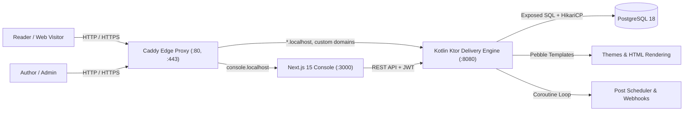

# TopLog

<p align="center">
  <strong>High-Performance Publishing Engine &amp; Modern Content Studio</strong>
  <br />
  Kotlin 21 + Ktor 3.1 Delivery Backend &bull; Next.js 15 Admin Console &bull; PostgreSQL 18 &bull; Caddy 2 On-Demand SSL
</p>

<p align="center">
  <a href="docs/DEPLOYMENT.md"><strong>Production Deployment Guide &raquo;</strong></a>
  <span> | </span>
  <a href="docs/SETUP_GUIDE.md"><strong>Setup &amp; Config Guide &raquo;</strong></a>
  <span> | </span>
  <a href="docs/ARCHITECTURE.md"><strong>Architecture Deep Dive &raquo;</strong></a>
  <span> | </span>
  <a href="DEV.md"><strong>Local Development &raquo;</strong></a>
</p>

---

## Highlights & Capabilities

- **High-Performance Multi-Tenant Architecture**: Host unlimited blogs across subdomains (`*.localhost` or `*.yourdomain.com`) and custom domains from a single deployment.
- **Modern Next.js 15 Console**: Fast, responsive administrative console built with Next.js 15 App Router, React 19, TypeScript, and Tailwind CSS.
- **TipTap Rich Text Studio with Media Drag & Drop**: Visual block editor supporting Markdown shortcuts, drag-and-drop and clipboard paste image uploads directly to local storage, and code formatting.
- **Native OpenRouter & LLM Engine**: 1-click multilingual translation and automated SEO optimization powered by OpenRouter, OpenAI, Groq, or DeepSeek with key configuration directly in the UI.
- **Code Syntax Highlighting with 1-Click Copy**: Built-in Highlight.js styling with One Dark palette and copy-to-clipboard buttons on all `<pre><code>` blocks in public reader posts.
- **First-Class Internationalization**: Multi-language variants per post (`en`, `es`, `fr`, etc.) with independent slugs, metadata, and body content.
- **Post Revision History & Rollback**: Automatic version snapshots recorded on every save, with a diff/preview modal and 1-click rollback in Post Studio.
- **Dynamic Open Graph & Social Cards**: Auto-generated 1200×630 vector SVG social preview cards (`/api/og/:slug`) with ambient glowing gradients, reading time, and brand watermarks.
- **Reading Experience**: Dynamic reading time estimation (`X min read`), sticky scroll-synced reading progress bar, and automated Table of Contents (TOC).
- **Dark Mode & Multi-Theme Switcher**: Visitor light/dark mode toggle respecting system preferences, persisted in local storage, and controllable per-blog in settings.
- **Full Blog Backup & Data Export**: 1-click `.zip` archive download bundling YAML frontmatter Markdown files, tags JSON, comments JSON, and subscribers CSV.
- **Automated Post Scheduler**: Background coroutine worker publishing scheduled articles and dispatching webhooks automatically.
- **Webhooks & Integrations**: Outgoing HTTP POST webhooks with HMAC-SHA256 signature verification and detailed delivery audit logs.
- **Reader Comments & Moderation**: Built-in discussion engine with multi-level reply threads, spam flagging, and status moderation (`PENDING`, `APPROVED`, `SPAM`).
- **Subscribers & Newsletter Campaigns**: Reader email subscription forms, unsubscribe tokens, and newsletter dispatches directly from published posts.
- **WordPress & Markdown Importers**: Instant migration from WordPress XML (WXR) exports or Markdown zip archives.
- **Zero-Touch SSL (Caddy 2)**: Automatic On-Demand TLS certificate issuance for custom domains via Let's Encrypt / ZeroSSL.

---

## System Architecture



---

## 5-Minute Quickstart

### Prerequisites
- [Docker](https://docs.docker.com/get-docker/) & [Docker Compose](https://docs.docker.com/compose/) installed.

### 1. Configure Environment
```bash
# Copy environment configuration
cp .env.example .env.app
```

### 2. Start the Stack
```bash
docker compose up -d --build
```

### 3. Configure Local Hosts
Add the following to your `/etc/hosts` file (macOS/Linux) or `C:\Windows\System32\drivers\etc\hosts`:
```text
127.0.0.1   console.localhost
127.0.0.1   tech.localhost
```

### 4. Access the Platform
- **Admin Console**: [http://console.localhost](http://console.localhost) (or [http://localhost:3000](http://localhost:3000))
  - **Email**: `admin@example.com`
  - **Password**: `password123`
- **Sample Blog**: [http://tech.localhost](http://tech.localhost) (or direct: [http://localhost:8080](http://localhost:8080) with `Host: tech.localhost`)

---

## Documentation

Detailed documentation is available in the [`docs/`](docs/) directory:

- [**Production Deployment Guide**](docs/DEPLOYMENT.md): Production hosting instructions for cloud VPS (Hetzner, DigitalOcean, AWS), wildcard DNS, Caddy On-Demand TLS, and automated backups.
- [**Setup & Config Guide**](docs/SETUP_GUIDE.md): Local development, environment configuration, custom domains, and platform architecture.
- [**Architecture Deep Dive**](docs/ARCHITECTURE.md): Database ERD, subsystem internals, sequence diagrams, and security models.
- [**Local Development Guide**](DEV.md): Running the Ktor backend and Next.js console natively on your local machine.

---

## Project Structure

```text
blogs/
├── backend/                  # Kotlin 21 + Ktor delivery engine & REST API
│   ├── src/main/kotlin/      # Application entry, API routing, domain models, services
│   ├── src/main/resources/   # Flyway migrations (db/migration/) & Pebble themes
│   └── build.gradle.kts      # Gradle build & dependencies
├── console/                  # Next.js 15 admin console
│   ├── src/app/              # Next.js App Router pages & API clients
│   ├── src/components/       # TipTap editor, sidebar, modals, UI widgets
│   └── package.json          # Node dependencies & Next.js config
├── Caddyfile                 # Caddy reverse proxy & On-Demand TLS config
├── docker-compose.yml        # Orchestration for DB, backend, console, and caddy
├── docs/                     # Comprehensive architectural & setup guides
├── .env.example              # Template environment configuration
└── DEV.md                    # Host-native development guidelines
```

---

## License

Open source under the [GNU Affero General Public License v3.0](LICENSE).
