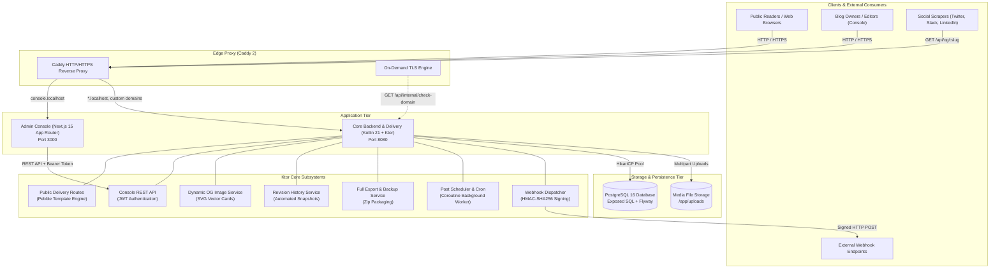
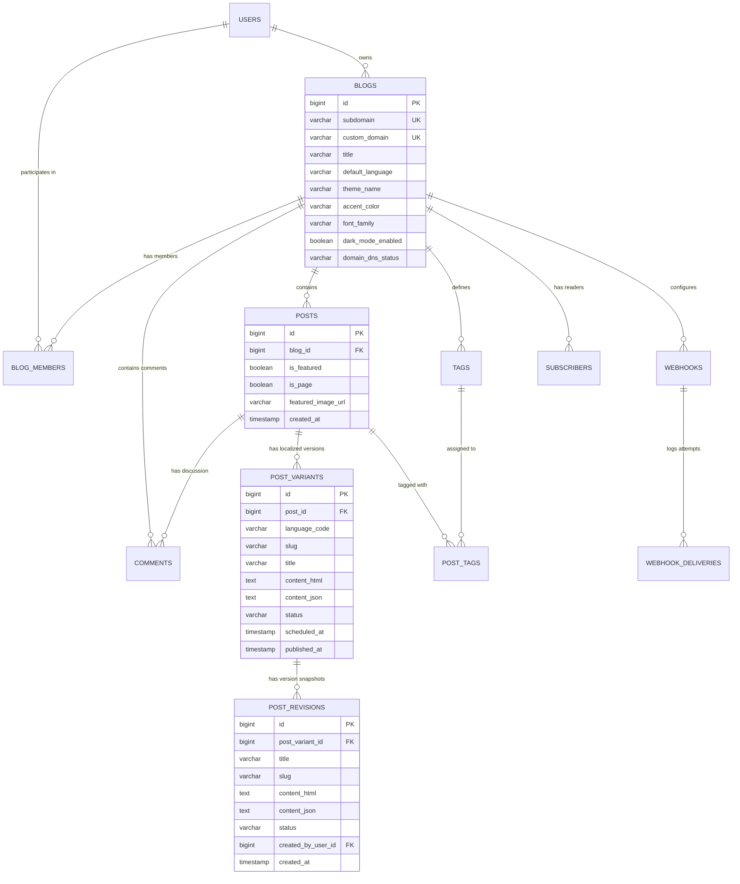
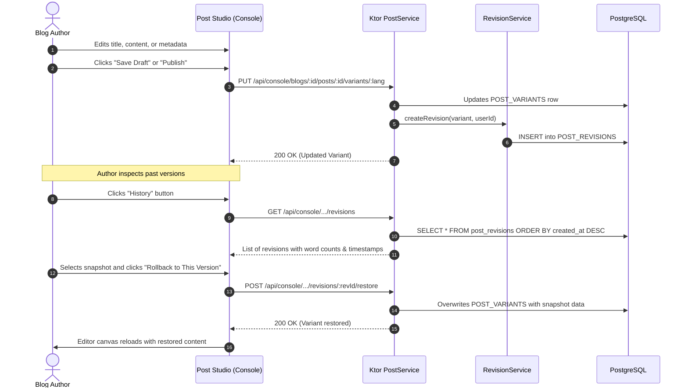

# Multi-Tenant Blogging Platform Architecture & Technical Deep Dive

This document details the internal architecture, design decisions, data flow, and subsystems of the blogging platform.

---

## 1. High-Level System Architecture



---

## 2. Technology Stack & Key Decisions

| Tier | Technology | Rationale |
|---|---|---|
| **Delivery & API** | **Kotlin 21 + Ktor 2.3** | High concurrency with lightweight coroutines, near-instant cold starts, strong typing, low memory footprint (~90MB RAM under load), and high throughput for public blog delivery. |
| **Console Frontend** | **Next.js 15 + React 19** | Fast SSR/client transitions, React Server Components where beneficial, clean App Router architecture, and modern TypeScript support. |
| **Rich Text Editor** | **TipTap (ProseMirror)** | Headless, extensible, produces clean semantic HTML and structured JSON, supports Markdown shortcuts, custom embeds, code highlights, and tables. |
| **Template Engine** | **Pebble Templates** | Jinja/Twig-inspired syntax for Java/Kotlin, sandboxed, fast parsing, built-in inheritance (`` and ``), easily themeable by web developers. |
| **Database & ORM** | **PostgreSQL 16 + Exposed SQL** | Rock-solid relational consistency, ACID guarantees, native JSONB support, and idiomatic Kotlin DSL via JetBrains Exposed. |
| **Migrations** | **Flyway 10** | Safe, repeatable, version-controlled schema evolution executed automatically on startup. |
| **Edge Proxy & TLS** | **Caddy 2** | Automatic HTTPS, HTTP/2 & HTTP/3 support, and unique **On-Demand TLS** allowing arbitrary custom domains to receive certificates without server restarts. |

---

## 3. Database Schema Overview

Flyway migrations (`backend/src/main/resources/db/migration/`) construct the relational model:



---

## 4. Subsystem Deep Dives

### 4.1 Multi-Tenant Routing Engine

1. **Host Header Resolution**:
   - The Ktor `DeliveryRoutes` module intercepts incoming requests.
   - Extracts the `Host` header (e.g. `tech.localhost:8080` or `blog.company.com`).
   - Resolves the tenant:
     ```kotlin
     val blog = blogService.getBlogByHost(host)
         ?: return@get call.respond(HttpStatusCode.NotFound, "Blog not found")
     ```
2. **Pebble Theme Rendering**:
   - Injects the resolved blog context, publication metadata, accent colors, and custom `<head>` / `<body>` tracking scripts.
   - Executes template inheritance from `themes/${blog.themeName}/layout.pebble`.

---

### 4.2 Post Revision History & Instant Rollback



---

### 4.3 Dynamic Open Graph & Social Cards

- **Route**: `GET /api/og/{slug}`
- **Renderer**: [`OgImageService.kt`](file:///Users/toptoppy/projects/blogs/backend/src/main/kotlin/com/app/service/OgImageService.kt)
- **Format**: SVG (`image/svg+xml`) rendered with:
  - 1200×630 canvas dimensions.
  - Ambient radial background glow using blog accent colors (`blog.accentColor`).
  - Word-wrapped post title with dynamic line-breaking calculations.
  - Published timestamp & dynamic reading time (`X min read`).
  - Branded publication tag and custom domain watermarks.
  - Response headers: `Cache-Control: public, max-age=86400` for edge caching by CDN and social platform crawlers.

---

### 4.4 Full Blog Backup & Export Pipeline

- **Route**: `GET /api/console/blogs/{blogId}/export.zip`
- **Output**: Compressed ZIP archive stream constructed by [`ExportService.kt`](file:///Users/toptoppy/projects/blogs/backend/src/main/kotlin/com/app/service/ExportService.kt):
  1. `metadata.json`: Complete serialized blog attributes (theme, typography, accent color, domain configs).
  2. `data/tags.json`: JSON dump of all taxonomy tags.
  3. `data/comments.json`: JSON dump of reader comments including parent/child reply hierarchy.
  4. `data/subscribers.csv`: RFC-4180 compliant CSV export of subscriber emails and statuses.
  5. `posts/{lang}/{slug}.md`: Individual Markdown documents equipped with YAML frontmatter:
     ```yaml
     ---
     title: "Building High-Performance Systems with Kotlin"
     slug: "building-high-performance-systems"
     language: "en"
     status: "PUBLISHED"
     published_at: "2026-10-30T02:02:46Z"
     tags: ["Kotlin", "Architecture"]
     ---

     <p>Body content...</p>
     ```

---

### 4.5 Scheduled Publishing & Webhook Dispatcher

- **Worker**: [`SchedulerService.kt`](file:///Users/toptoppy/projects/blogs/backend/src/main/kotlin/com/app/service/SchedulerService.kt) operates a Kotlin Coroutine loop running every 30 seconds.
- **Workflow**:
  1. Queries all post variants where `status = 'SCHEDULED'` and `scheduled_at <= NOW()`.
  2. Atomically transitions their status to `'PUBLISHED'` and sets `published_at = NOW()`.
  3. Dispatches asynchronous webhook payloads (`post.published`) to all active URLs configured for that blog.
  4. Each webhook HTTP request includes:
     - `X-Blog-Event`: `post.published`
     - `X-Blog-Signature`: `sha256=HMAC_SHA256(secret, payload)`
  5. Records HTTP response code and execution latency in `webhook_deliveries`.

---

## 5. Security & Isolation Model

1. **Authentication**: Stateless HMAC-SHA256 JWT tokens with 24-hour expiration, validated by Ktor's `jwt("auth-jwt")` authentication provider.
2. **Multi-Tenant Isolation**: Every database query scoped to console endpoints enforces `WHERE blog_id = :blogId` and verifies that the calling user holds an active membership record in `blog_members` or is the blog `owner_id`.
3. **Role-Based Access Control (RBAC)**:
   - `ADMIN`: Full control including billing, member management, code injection, and deletion.
   - `EDITOR`: Create, edit, and publish posts and manage tags and comments.
   - `AUTHOR`: Create and edit own draft posts; cannot publish without editor approval.
4. **On-Demand TLS Guard**: Caddy queries the backend internal verification route before requesting certificates from Let's Encrypt, preventing malicious domain exhaustion attacks.
