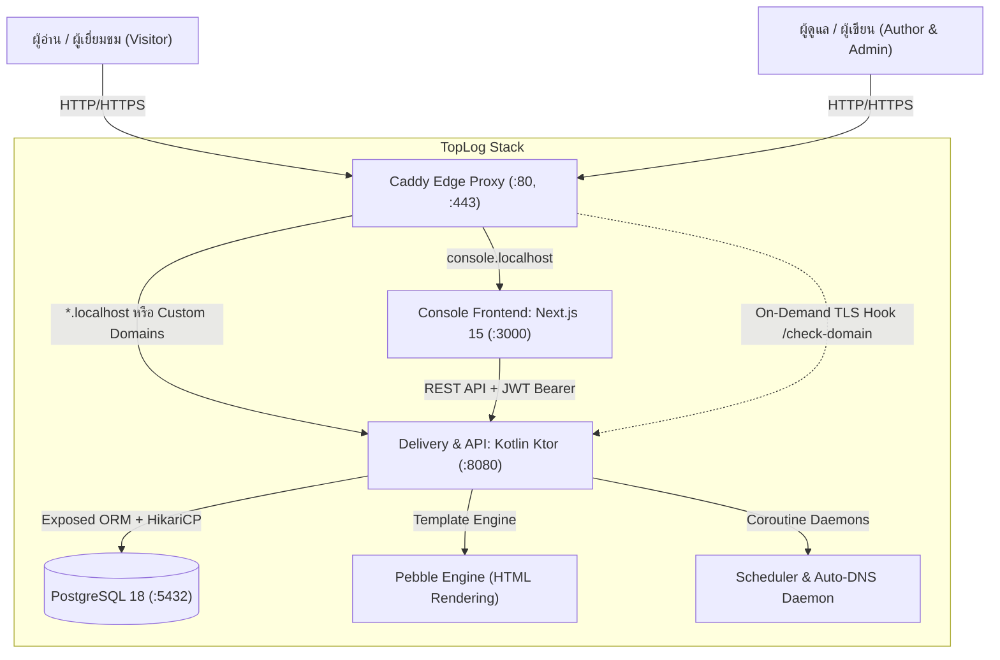

# TopLog Cookbook: คู่มือการใช้งานและแก้ปัญหาฉบับลงมือปฏิบัติจริง (ภาษาไทย)

ยินดีต้อนรับสู่ **TopLog Cookbook** เอกสารคู่มือภาคปฏิบัติที่รวบรวม "สูตรและวิธีการทำงาน" (Recipes) ตั้งแต่ระดับเริ่มต้นไปจนถึงระดับสูง สำหรับผู้ดูแลระบบ (DevOps/Admin), นักพัฒนา (Developer) และนักเขียน (Author/Editor) บนแพลตฟอร์ม **TopLog (`v1.2.0`)**

---

## สารบัญสูตร (Recipes Table of Contents)

1. [โครงสร้างสถาปัตยกรรมและภาพรวมของระบบ (System Overview)](#1-โครงสร้างสถาปัตยกรรมและภาพรวมของระบบ)
2. [Recipe 1: เริ่มต้นระบบอย่างรวดเร็วด้วย Docker Compose](#recipe-1-เริ่มต้นระบบอย่างรวดเร็วด้วย-docker-compose)
3. [Recipe 2: การสร้างบล็อกและการปรับแต่งแบรนด์ (Branding & Settings)](#recipe-2-การสร้างบล็อกและการปรับแต่งแบรนด์)
4. [Recipe 3: สตูดิโอเขียนบทความ TipTap และการจัดการเนื้อหาหลายภาษา (i18n Variants)](#recipe-3-สตูดิโอเขียนบทความ-tiptap-และการจัดการเนื้อหาหลายภาษา)
5. [Recipe 4: การใช้งานระบบประวัติย้อนหลัง (Revisions History & Rollback)](#recipe-4-การใช้งานระบบประวัติย้อนหลัง)
6. [Recipe 5: การเชื่อมต่อ AI Assistant (OpenRouter / OpenAI / Groq / DeepSeek)](#recipe-5-การเชื่อมต่อ-ai-assistant)
7. [Recipe 6: ระบบตั้งเวลาเผยแพร่บทความอัตโนมัติ (Automated Post Scheduling)](#recipe-6-ระบบตั้งเวลาเผยแพร่บทความอัตโนมัติ)
8. [Recipe 7: สตูดิโอตรวจสอบ SEO & ตัวอย่างการแชร์โซเชียล (SEO & Social Share Preview)](#recipe-7-สตูดิโอตรวจสอบ-seo--ตัวอย่างการแชร์โซเชียล)
9. [Recipe 8: ระบบค้นหาบทความแบบเรียลไทม์ (Instant Search & Topic Archives)](#recipe-8-ระบบค้นหาบทความแบบเรียลไทม์)
10. [Recipe 9: การเชื่อมต่อโดเมนของตัวเองและระบบออกใบรับรอง SSL อัตโนมัติ (Custom Domain & On-Demand TLS)](#recipe-9-การเชื่อมต่อโดเมนของตัวเองและระบบออกใบรับรอง-ssl-อัตโนมัติ)
11. [Recipe 10: การจัดการสมาชิก จดหมายข่าว และระบบคอมเมนต์ (Subscribers, Newsletters & Comments)](#recipe-10-การจัดการสมาชิก-จดหมายข่าว-และระบบคอมเมนต์)
12. [Recipe 11: การสำรองข้อมูล การส่งออก และการย้ายค่าย (Backup, Export & Import)](#recipe-11-การสำรองข้อมูล-การส่งออก-และการย้ายค่าย)
13. [Recipe 12: การรันชุดทดสอบและการตรวจสอบ Code Coverage (Automated Testing & JaCoCo)](#recipe-12-การรันชุดทดสอบและการตรวจสอบ-code-coverage)
14. [Recipe 13: แนวทางปฏิบัติการนำขึ้นเซิร์ฟเวอร์จริง (Production Deployment Guide)](#recipe-13-แนวทางปฏิบัติการนำขึ้นเซิร์ฟเวอร์จริง)
15. [การแก้ไขปัญหาที่พบบ่อย (Troubleshooting & FAQs)](#การแก้ไขปัญหาที่พบบ่อย-troubleshooting--faqs)

---

## 1. โครงสร้างสถาปัตยกรรมและภาพรวมของระบบ

TopLog ถูกออกแบบตามหลัก **Separation of Concerns (SoC)** และ **Multi-Tenant First**:



### รายละเอียดเซอร์วิสหลัก
- **Backend (`toplog-backend`)**: พัฒนาด้วย **Kotlin 21 + Ktor 3.1** ใช้เฟรมเวิร์ก Exposed ORM, Flyway Migrations, และ Pebble Template Engine สำหรับเรนเดอร์หน้าเว็บสาธารณะด้วยความเร็วสูง
- **Console (`toplog-console`)**: พัฒนาด้วย **Next.js 15 (App Router), React 19, TypeScript และ Tailwind CSS** พร้อมโปรแกรมตัดต่อ TipTap และ UI แบบ Minimalist
- **Gateway (`toplog-caddy`)**: **Caddy 2 Server** ทำหน้าที่เป็น Reverse Proxy, SSL Termination และออกใบรับรอง Let's Encrypt แบบ On-Demand อัตโนมัติ
- **Database (`toplog-postgres`)**: **PostgreSQL 18** จัดเก็บข้อมูลแบบแยก Tenant อย่างปลอดภัย

---

## Recipe 1: เริ่มต้นระบบอย่างรวดเร็วด้วย Docker Compose

สูตรนี้จะพาคุณติดตั้งและรัน TopLog บนเครื่อง Local ภายในเวลาไม่เกิน 3 นาที

### ขั้นตอนการทำ
1. **คัดลอกไฟล์การตั้งค่าสภาพแวดล้อม (Environment Configuration):**
   ```bash
   cp .env.example .env.app
   ```

2. **สั่งรันคอนเทนเนอร์ทั้งหมดผ่าน Docker Compose:**
   ```bash
   docker compose up -d --build
   ```

3. **ตรวจสอบสถานะคอนเทนเนอร์:**
   ```bash
   docker compose ps
   ```
   *ผลลัพธ์ที่ถูกต้อง คอนเทนเนอร์ทั้ง 4 ตัวต้องขึ้นสถานะ `Up (healthy)`:*
   - `toplog-backend` (Port 8080)
   - `toplog-console` (Port 3000)
   - `toplog-caddy` (Port 80, 443)
   - `toplog-postgres` (Port 5432)

4. **ตั้งค่า Local Domain Resolution ใน `/etc/hosts`:**
   เปิดไฟล์ `/etc/hosts` (macOS/Linux) หรือ `C:\Windows\System32\drivers\etc\hosts` (Windows) ด้วยสิทธิ์ Admin แล้วเพิ่มบรรทัดต่อไปนี้:
   ```text
   127.0.0.1   console.localhost
   127.0.0.1   tech.localhost
   127.0.0.1   engineering.localhost
   ```

5. **เข้าใช้งานระบบ:**
   - **Admin Console**: [http://console.localhost](http://console.localhost)
     - **Email**: `admin@example.com`
     - **Password**: `password123`
   - **บล็อกตัวอย่าง (Public Blog)**: [http://tech.localhost](http://tech.localhost)

---

## Recipe 2: การสร้างบล็อกและการปรับแต่งแบรนด์

TopLog รองรับการสร้างบล็อกได้ไม่จำกัดจำนวน โดยแต่ละบล็อกมีอิสระในการกำหนด Subdomain, ธีม, โลโก้ และการตั้งค่าของตัวเอง

### 1. การสร้างบล็อกใหม่ผ่าน Console UI
1. เข้าสู่ระบบที่ `http://console.localhost`
2. ที่มุมบนซ้าย คลิกเมนูเลือกบล็อก แล้วเลือก **"Create New Publication"**
3. กรอกข้อมูล:
   - **Subdomain**: เช่น `mytech` (จะได้ URL: `mytech.localhost`)
   - **Title**: ชื่อสื่อหรือบล็อกของคุณ เช่น `My Tech Journal`
   - **Language**: ภาษาหลัก เช่น `en` หรือ `th`
4. คลิก **"Create Blog"**

### 2. การสร้างบล็อกผ่าน REST API
```bash
TOKEN="<YOUR_JWT_TOKEN>"

curl -X POST https://api.localhost/api/console/blogs \
  -H "Authorization: Bearer $TOKEN" \
  -H "Content-Type: application/json" \
  -d '{
    "subdomain": "devjournal",
    "title": "Developer Journal",
    "description": "เรื่องราวการพัฒนาซอฟต์แวร์และสถาปัตยกรรมระบบ",
    "defaultLanguage": "th",
    "accentColor": "#0ea5e9",
    "fontFamily": "Inter"
  }'
```

### 3. การปรับแต่ง Branding และ Code Injection
ไปที่หน้า **Settings (`/blogs/[blogId]/settings`)**:
- **Tab Branding**: ปรับแต่ง Accent Color, ฟอนต์หลัก, อัปโหลด Logo และ Favicon
- **Tab Code Injection**: ใส่สคริปต์เสริมสำหรับวิเคราะห์ข้อมูลหรือตกแต่ง:
  - `Code Head`: สคริปต์ Google Analytics, Google Tag Manager หรือฟอนต์ภาษาไทย เช่น Prompt, Sarabun:
    ```html
    <link rel="preconnect" href="https://fonts.googleapis.com">
    <link href="https://fonts.googleapis.com/css2?family=Prompt:wght@400;600;700&display=swap" rel="stylesheet">
    <style>
      :root { --font-sans: 'Prompt', sans-serif !important; }
    </style>
    ```
  - `Code Foot`: สคริปต์ Custom Chat Widget หรือแบบสอบถาม

---

## Recipe 3: สตูดิโอเขียนบทความ TipTap และการจัดการเนื้อหาหลายภาษา

TipTap Editor ใน TopLog รองรับการจัดรูปแบบข้อความขั้นสูง การลากวางรูปภาพ และการสร้างเนื้อหาคู่ขนานหลายภาษา (Multilingual Variants) ในบทความเดียวกัน

### 1. คีย์ลัดใน TipTap Editor ที่ใช้บ่อย
- `#` + Space: หัวข้อระดับ 1 (`<h1>`)
- `##` + Space: หัวข้อระดับ 2 (`<h2>`)
- `###` + Space: หัวข้อระดับ 3 (`<h3>`)
- ```` ``` ```` + Space: บล็อกโค้ดพร้อม Syntax Highlighting
- `-` หรือ `*` + Space: รายการสัญลักษณ์ (Bullet List)
- `1.` + Space: รายการตัวเลข (Numbered List)
- `>` + Space: กล่องข้อความอ้างอิง (Blockquote)
- `Ctrl/Cmd + B`: ตัวหนา
- `Ctrl/Cmd + I`: ตัวเอียง
- `Ctrl/Cmd + K`: แทรกไฮเปอร์ลิงก์

### 2. การอัปโหลดรูปภาพแบบ Drag & Drop
- สามารถลากไฟล์ภาพ (`.png`, `.jpg`, `.webp`) จากคอมพิวเตอร์มาวางในหน้าต่าง Editor ได้ทันที
- รองรับการกด `Ctrl/Cmd + V` เพื่อวางรูปภาพที่ Copy มาจากคลิปบอร์ด
- ระบบจะอัปโหลดไปยัง Storage ของบล็อกนั้นๆ โดยแยกโฟลเดอร์ตาม ID และป้องกัน Path Traversal อัตโนมัติ

### 3. การสร้างเนื้อหาหลายภาษา (Language Variants)
TopLog จัดเก็บ 1 โพสต์ (`Posts`) ให้มีหลายฉบับภาษา (`PostVariants`) ได้อย่างเป็นอิสระต่อกัน:
1. ที่แถบด้านบนของบทความ จะมีปุ่มเลือกภาษา เช่น `[EN]`, `[TH]`, `[+ Add Language]`
2. คลิก **"+ Add Language"** เลือกภาษาที่ต้องการ (เช่น `th`)
3. กรอก Title และ Slug ประจำภาษานั้น (เช่น `getting-started-th`)
4. คุณสามารถเขียนเนื้อหาภาษาไทยแยกต่างหาก โดยระบบจะเชื่อมโยง Variant ทั้งหมดเข้าด้วยกันสำหรับการสลับภาษาบนหน้าเว็บสาธารณะ

---

## Recipe 4: การใช้งานระบบประวัติย้อนหลัง

ทุกครั้งที่คุณบันทึกบทความ ระบบจะบันทึก Snapshot เวอร์ชันก่อนหน้าลงในตาราง `post_revisions` โดยอัตโนมัติ เพื่อป้องกันการสูญหายของข้อมูล

### วิธีการดูและย้อนกลับเวอร์ชัน (Rollback)
1. ในหน้าแก้ไขบทความ คลิกปุ่ม **"History"** บนแถบเครื่องมือด้านบน
2. หน้าต่าง Modal จะแสดงประวัติการแก้ไขตามเวลาและผู้แก้ไข
3. คลิกเลือกเวอร์ชันในอดีตเพื่อพรีวิวความแตกต่างของเนื้อหา
4. คลิกปุ่ม **"Restore this Version"** เพื่อนำเนื้อหาเวอร์ชันดังกล่าวกลับมาใช้งานทันที

---

## Recipe 5: การเชื่อมต่อ AI Assistant

TopLog ฝังระบบ AI อัจฉริยะที่เชื่อมต่อกับ **OpenRouter**, **OpenAI**, **Groq**, **DeepSeek** หรือผู้ให้บริการอื่นๆ ที่รองรับมาตรฐาน OpenAI API

### 1. การตั้งค่า API Key
คุณสามารถระบุ API Key ได้ 2 ระดับ:
- **ระดับระบบ**: กำหนดในไฟล์ `.env.app` (`OPENROUTER_API_KEY=sk-or-v1-...` หรือ `AI_API_KEY=sk-...`)
- **ระดับบล็อก (Per-Blog Key)**: ไปที่หน้า **Settings > AI Settings** ใน Console
  - เลือก Provider Preset (OpenRouter, OpenAI, Groq, DeepSeek, หรือ Custom)
  - ใส่ API Key ส่วนตัวของบล็อก
  - กดปุ่ม **"Test Connection"** เพื่อตรวจสอบความถูกต้อง

### 2. สูตรการแปลบทความ 1-Click Translation
1. เปิดบทความต้นฉบับ (เช่น ภาษาอังกฤษ)
2. คลิกปุ่ม **"AI Actions" > "Translate with AI"**
3. เลือกภาษาปลายทาง (เช่น `Thai (th)`)
4. AI จะแปลทั้งหัวข้อ, Slug, สรุปย่อ และเนื้อหา HTML โดยยังคงรักษารูปแบบ Markdown, โค้ด และรูปภาพไว้ครบถ้วน
5. ตรวจทานเนื้อหาแล้วกด **"Save as Thai Variant"**

### 3. สูตรการสร้าง SEO Meta Description ด้วย AI
1. เปิดลิ้นชัก **"Settings"** หรือคลิก **"SEO & Social"**
2. ในช่อง Meta Description คลิกปุ่มรูปดาวประกาย **"AI Generate"**
3. AI จะอ่านเนื้อหาของบทความแล้วสรุปเป็นคำบรรยายที่กระชับ ไม่เกิน 160 ตัวอักษร เหมาะแก่การแสดงผลบนผลการค้นหาของ Google

---

## Recipe 6: ระบบตั้งเวลาเผยแพร่บทความอัตโนมัติ

TopLog มี Background Coroutine Scheduler ที่คอยตรวจสอบและเผยแพร่บทความเมื่อถึงเวลาที่กำหนด โดยแบ่งแยกการทำงานตาม Tenant ของบล็อก

### 1. วิธีตั้งเวลาเผยแพร่ผ่าน UI
1. ใน Post Studio คลิกปุ่มดรอปดาวน์ข้างปุ่ม Publish แล้วเลือก **"Schedule Publication"**
2. เลือกวันและเวลาที่ต้องการเผยแพร่
3. คลิก **"Schedule Post"** สถานะของบทความจะเปลี่ยนเป็น `SCHEDULED`

### 2. การทำงานของเบื้องหลัง
- `SchedulerService.kt` จะทำงานวนรอบใน Background ทุกๆ 30 วินาที
- ค้นหาบทความที่มีสถานะ `SCHEDULED` และเวลา `scheduledAt <= Instant.now()`
- อัปเดตสถานะเป็น `PUBLISHED`, ล้าง `scheduledAt`, และอัปเดต `publishedAt`
- ส่งสัญญาณเรียก **Outgoing Webhooks** ให้บริการภายนอกทราบทันที

### 3. การทดสอบสั่งรัน Scheduler ด้วยตนเอง (Manual Trigger API)
```bash
curl -X POST https://api.localhost/api/console/blogs/1/posts/scheduler/run \
  -H "Authorization: Bearer $TOKEN"
```
*ตัวอย่างการตอบกลับ:*
```json
{
  "publishedCount": 2,
  "message": "Scheduler run successfully completed. Published 2 post(s)."
}
```

---

## Recipe 7: สตูดิโอตรวจสอบ SEO & ตัวอย่างการแชร์โซเชียล

ฟีเจอร์นี้เปิดโอกาสให้นักเขียนเห็นหน้าตาบทความของตนเองเสมือนจริงบน Google และ Social Media ก่อนกดเผยแพร่จริง

### การเรียกใช้งาน
คลิกปุ่ม **"SEO & Social"** บนแถบเครื่องมือของ Post Studio:

```
+-----------------------------------------------------------------------+
|  SEO & Social Share Preview                               [SEO: 95/100] |
+-----------------------------------------------------------------------+
|  [Google SERP]   [Social Cards]   [Metadata & Canonical]   [Checklist]|
+-----------------------------------------------------------------------+
```

### สูตรการใช้งานแต่ละแท็บ
1. **Google SERP Tab**:
   - เลือกระหว่างมุมมอง **Desktop** และ **Mobile**
   - แสดง Favicon, Breadcrumb URL (`domain › slug`), ชื่อไตเติลสีน้ำเงิน, และข้อความ Snippet
   - มีเกจวัดความยาว Title (แนะนำไม่เกิน 60 ตัวอักษร) และ Description (แนะนำ 120-160 ตัวอักษร)
2. **Social Cards Tab**:
   - พรีวิวการแสดงผลจริงบน **Twitter / X** (Large Summary Card), **Facebook Feed**, และ **LinkedIn Article**
   - ดึงภาพ Cover Image หรือภาพเรนเดอร์ Vector SVG สดจาก `/og-preview`
3. **Metadata & Canonical Override Tab**:
   - แก้ไข Slug, Meta Title, และ Meta Description ได้ทันทีในหน้าต่างเดียว
   - **Canonical URL**: สำหรับบทความที่นำมาจาก Medium, Substack หรือเว็บบริษัทอื่น ให้ระบุ URL ต้นทางในช่องนี้เพื่อป้องกัน Google ปรับลดคะแนน SEO (Duplicate Content Penalty)
4. **Audit Checklist Tab**:
   - ประเมินคะแนน SEO Readiness (0–100) อัตโนมัติ พร้อมรายการตรวจสอบความพร้อม 5 ด้าน

---

## Recipe 8: ระบบค้นหาบทความแบบเรียลไทม์

TopLog มาพร้อมระบบค้นหาบทความแบบ Fast Full-Text และระบบคลังบทความแยกตามหมวดหมู่ Tag

### 1. การใช้งานบนหน้าเว็บของผู้อ่าน
- ผู้อ่านสามารถกดคีย์ลัด **`Cmd + K`** (macOS) หรือ **`Ctrl + K`** (Windows/Linux) บนหน้าบล็อกเพื่อเปิดหน้าต่าง Instant Search Modal
- พิมพ์คำค้นหาเพื่อค้นหาหัวข้อและเนื้อหาได้แบบพิมพ์แล้วขึ้นทันที
- คลิกเลือกแท็บหัวข้อบน Navigation Bar เช่น `#Architecture`, `#Kotlin` เพื่อดูบทความทั้งหมดในหมวดหมู่นั้น

### 2. การค้นหาผ่าน Public Search API
```bash
# ค้นหาด้วยคำว่า "system" เฉพาะในหมวดหมู่แท็บ "architecture"
curl -s "https://tech.localhost/api/search?q=system&tag=architecture" | jq .
```
*ตัวอย่างผลลัพธ์:*
```json
{
  "query": "system",
  "total": 1,
  "results": [
    {
      "id": 1,
      "title": "High-Performance System Architecture",
      "slug": "high-performance-system-architecture",
      "description": "Deep dive into reactive pipelines and scalable databases.",
      "featuredImageUrl": "https://images.unsplash.com/photo-...",
      "publishedAt": "2026-11-01T12:00:00Z",
      "tags": ["Architecture", "Kotlin"]
    }
  ]
}
```

---

## Recipe 9: การเชื่อมต่อโดเมนของตัวเองและระบบออกใบรับรอง SSL อัตโนมัติ

TopLog `v1.2.0` มีระบบ **Auto-DNS Verification** และ **Caddy On-Demand TLS** ช่วยให้คุณผูกโดเมนส่วนตัว (เช่น `blog.mycompany.com`) ได้อย่างปลอดภัย โดยไม่ต้องแก้ไขไฟล์คอนฟิกของเว็บเซิร์ฟเวอร์ด้วยตนเอง

### ขั้นตอนการตั้งค่าโดเมนแบบ Step-by-Step

#### 1. เพิ่มระเบียน DNS ที่ผู้ให้บริการโดเมนของคุณ
ไปที่ผู้ให้บริการ DNS ของคุณ (Cloudflare, Namecheap, Route53 ฯลฯ) แล้วเพิ่มระเบียน **CNAME**:
- **Type**: `CNAME`
- **Host / Name**: `blog` (หรือชื่อ Subdomain ที่ต้องการ หรือ `@` หากเป็น Root Domain)
- **Target / Value**: ชี้ไปยังโดเมนหลักของเซิร์ฟเวอร์ TopLog (เช่น `tech.yourdomain.com` หรือ IP เซิร์ฟเวอร์)
- **TTL**: `Auto` หรือ `300`

#### 2. ผูกโดเมนในหน้า Settings
1. เข้าไปที่ **Settings > General & Domain** ใน Console
2. ในช่อง **Custom Domain** พิมพ์โดเมนของคุณ เช่น `blog.mycompany.com`
3. กดปุ่ม **"Save Settings"**

#### 3. การตรวจสอบ DNS (Auto-DNS Resolution)
- ในหน้าจอจะมีตารางข้อมูล DNS พร้อมปุ่ม **"Verify DNS Now"**
- เมื่อคลิก ระบบจะส่งคำขอไปที่ `POST /api/console/blogs/{id}/domain/verify` เพื่อตรวจสอบว่าโดเมนชี้มายัง IP ของเซิร์ฟเวอร์จริงหรือไม่
- **Background Auto-DNS**: หาก DNS ยังไม่กระจายตัว (Propagating) คุณสามารถปิดหน้าจอได้ เซอร์วิสเบื้องหลังของ TopLog จะคอยตรวจสอบซ้ำให้ทุกๆ 60 วินาที และเปลี่ยนสถานะเป็น `VERIFIED` ให้อัตโนมัติเมื่อระเบียนพร้อม

#### 4. กลไกความปลอดภัย Caddy On-Demand TLS Hook
เมื่อมีผู้เยี่ยมชมเรียกเข้ามาที่ `https://blog.mycompany.com` Caddy จะตรวจสอบกับ Backend ผ่าน Endpoint ภายใน:
```text
GET http://backend:8080/api/internal/check-domain?domain=blog.mycompany.com
```
- หากโดเมนลงทะเบียนถูกต้องและมีสถานะ `VERIFIED` -> Backend ตอบ `200 OK` และ Caddy จะทำการขอใบรับรอง Let's Encrypt และเริ่มเข้ารหัส HTTPS ให้ทันที
- หากโดเมนไม่ได้ลงทะเบียนหรือ DNS ยังไม่ชี้มา -> Backend ตอบ `403/404` ทำให้ Caddy ไม่ยื่นขอใบรับรอง ป้องกันการติด Limit (Rate Limit) ของ Let's Encrypt

---

## Recipe 10: การจัดการสมาชิก จดหมายข่าว และระบบคอมเมนต์

### 1. ระบบสมาชิกและจดหมายข่าว (Subscribers & Newsletter)
- **แบบฟอร์มสมัครสมาชิก**: ทุกธีมจะมีกล่องรับข่าวสารท้ายบทความ ซึ่งส่งข้อมูลเข้า `POST /api/subscribe`
- **การส่งจดหมายข่าว**: ในหน้ารายการบทความหรือหน้ารายละเอียดบทความ คุณสามารถเลือกบทความที่เผยแพร่แล้ว แล้วคลิก **"Send as Newsletter"** เพื่อบรอดแคสต์เนื้อหาไปยังสมาชิกทั้งหมด
- **One-Click Unsubscribe**: จดหมายข่าวจะแนบโทเค็นยกเลิกสมาชิกเฉพาะบุคคล (`/unsubscribe?token=...`) เพื่อให้เป็นไปตามมาตรฐาน PDPA และ GDPR

### 2. ระบบความคิดเห็นผู้อ่านและการคัดกรอง (Comments & Moderation)
- ผู้อ่านสามารถส่งความคิดเห็นได้ที่ท้ายบทความ
- ความคิดเห็นใหม่จะเข้าสู่สถานะ `PENDING`
- ผู้ดูแลสามารถเข้าไปที่เมนู **Comments (`/blogs/[blogId]/comments`)** เพื่อ:
  - **Approve**: อนุมัติให้แสดงผลบนหน้าเว็บ
  - **Mark as Spam**: คัดกรองว่าเป็นสแปม
  - **Delete**: ลบความคิดเห็นทิ้ง

---

## Recipe 11: การสำรองข้อมูล การส่งออก และการย้ายค่าย

TopLog ให้ความสำคัญกับกรรมสิทธิ์ในข้อมูล (Data Ownership) จึงมีระบบสำรองข้อมูลและนำเข้าข้อมูลครบวงจร

### 1. การดาวน์โหลด Full Backup Archive (.zip)
1. ไปที่หน้า **Settings > General & Domain**
2. เลื่อนลงมาที่หัวข้อ **Full Blog Backup & Data Export**
3. คลิกปุ่ม **"Download Full Archive (.zip)"**
4. คุณจะได้รับไฟล์ ZIP ที่ประกอบด้วย:
   - ไฟล์ Markdown (`.md`) พร้อม YAML Frontmatter สำหรับทุกบทความและทุกฉบับภาษา
   - `tags.json`: ข้อมูลแท็กและหมวดหมู่ทั้งหมด
   - `subscribers.csv`: รายชื่อสมาชิกอีเมล
   - `comments.json`: ประวัติความคิดเห็นทั้งหมด

### 2. การนำเข้าข้อมูลจาก WordPress หรือ Markdown
1. ไปที่เมนู **Import (`/blogs/[blogId]/import`)**
2. เลือกรูปแบบไฟล์ต้นทาง:
   - **WordPress XML (WXR Export)**: อิมพอร์ตโพสต์, วันที่เผยแพร่, แท็ก, และรูปภาพจากเว็บบล็อกเดิม
   - **Markdown ZIP**: อิมพอร์ตไฟล์ `.md` จำนวนมากพร้อมกัน
3. ระบบจะดำเนินการแปลงและบันทึกเข้าสู่ฐานข้อมูลของบล็อกนั้นทันที

---

## Recipe 12: การรันชุดทดสอบและการตรวจสอบ Code Coverage

TopLog มีชุดทดสอบอัตโนมัติครบทั้งฝั่ง Backend และ Frontend

### 1. รันการทดสอบ Backend พร้อมสร้างรายงาน JaCoCo
```bash
cd backend
./gradlew test jacocoTestReport
```
- ทดสอบการเข้ารหัส Password Hashing (BCrypt)
- ทดสอบระบบตั้งเวลาเผยแพร่บทความอัตโนมัติ (Scheduler Isolation)
- ทดสอบความปลอดภัยพื้นที่จัดเก็บไฟล์ (Path Traversal & Extension Stripping)
- ทดสอบ API Integration ครบวงจร (Auth, Posts, SEO Preview, RSS, Sitemap, Search, Domain Verification)
- **เปิดดูรายงาน Code Coverage สรุปผล:**
  ```bash
  open build/reports/jacoco/test/html/index.html
  ```

### 2. รันการทดสอบ Frontend Console ด้วย Vitest
```bash
cd console
npm test
```
- รันการทดสอบ Component สำหรับ `SeoPreviewModal.test.tsx`, `PostSettingsDrawer.test.tsx`, `GeneralDomainTab.test.tsx`, และ `api.test.ts`
- ใช้เวลาเพียง ~1.2 วินาที ด้วย Vitest + React Testing Library (JSDOM)

---

## Recipe 13: แนวทางปฏิบัติการนำขึ้นเซิร์ฟเวอร์จริง

### 1. เตรียมความพร้อมเซิร์ฟเวอร์ (Ubuntu / Debian VPS)
1. ติดตั้ง Docker Engine และ Docker Compose v2
2. กำหนดค่า Firewall (UFW):
   ```bash
   ufw allow 80/tcp
   ufw allow 443/tcp
   ufw allow 22/tcp
   ufw enable
   ```

### 2. ปรับแต่งไฟล์สภาพแวดล้อมสำหรับการใช้งานจริง
สร้างไฟล์ `.env.app` บนเซิร์ฟเวอร์จริง:
```ini
BASE_DOMAIN=yourdomain.com
CONSOLE_DOMAIN=console.yourdomain.com

DB_USER=postgres
DB_PASSWORD=<GENERATE_STRONG_RANDOM_PASSWORD>
DB_NAME=toplogdb

JWT_SECRET=<GENERATE_SECURE_64_CHAR_HEX_STRING>
STORAGE_UPLOADS_DIR=/app/uploads

# ระบุ OpenRouter หรือ OpenAI API Key สำหรับความสามารถด้าน AI
OPENROUTER_API_KEY=sk-or-v1-...
```

### 3. รัน Production Stack
```bash
docker compose -f docker-compose.prod.yml up -d --build
```

---

## การแก้ไขปัญหาที่พบบ่อย (Troubleshooting & FAQs)

### Q1: เรียกเข้าหน้าบล็อก `http://tech.localhost` แล้วขึ้น 404 Not Found
* **สาเหตุ**: ไม่ได้เพิ่มระเบียนลงในไฟล์ `/etc/hosts` ของเครื่องคุณ หรือใช้คำขอที่ไม่มี `Host` header
* **วิธีแก้**: ตรวจสอบว่าใน `/etc/hosts` มีบรรทัด `127.0.0.1 tech.localhost` แล้ว และทดสอบด้วยคำสั่ง:
  ```bash
  curl -i -H "Host: tech.localhost" http://localhost:8080/
  ```

### Q2: Caddy ไม่ออกใบรับรอง SSL สำหรับ Custom Domain
* **สาเหตุ**: ระเบียน DNS ยังไม่ได้ชี้มาที่เซิร์ฟเวอร์ หรือ Endpoint `/api/internal/check-domain` ปฏิเสธคำขอ
* **วิธีแก้**:
  1. ตรวจสอบว่าโดเมนในตาราง `blogs` ได้รับการยืนยันแล้วหรือไม่ (`domain_dns_status = 'VERIFIED'`)
  2. ทดสอบยิงคำขอตรวจสอบจำลอง:
     ```bash
     curl -i "http://localhost:8080/api/internal/check-domain?domain=yourdomain.com"
     ```
     หากตอบ `200 OK` Caddy จะสามารถออกใบรับรองได้ทันทีเมื่อมีคนเรียกเข้าผ่านพอร์ต 443

### Q3: ลืมรหัสผ่านของบัญชีผู้ดูแลระบบ (Admin Password Reset)
* **วิธีแก้**: คุณสามารถ Generate BCrypt Hash ใหม่ แล้วอัปเดตลงในฐานข้อมูลโดยตรงผ่าน Docker:
  ```bash
  # รหัสผ่านตัวอย่าง: password123
  NEW_HASH='$2a$12$IRtxFEz6WBvgVf9o/ZRDleLBg7MaJV7XLXPaGhjbDtdoUOTZFsK4O'
  docker compose exec db psql -U postgres -d blogdb -c \
    "UPDATE users SET password_hash = '$NEW_HASH' WHERE email = 'admin@example.com';"
  ```

### Q4: การตรวจสอบ Log ของคอนเทนเนอร์เมื่อเกิดปัญหา
```bash
# ตรวจสอบ Log ของทุกเซอร์วิสแบบ Real-time
docker compose logs -f

# ตรวจสอบเฉพาะ Backend
docker compose logs -f backend

# ตรวจสอบเฉพาะ Caddy Proxy
docker compose logs -f caddy
```

---

*เอกสารฉบับนี้อัปเดตล่าสุดสำหรับ **TopLog v1.2.0** สมบูรณ์และพร้อมใช้งาน*
