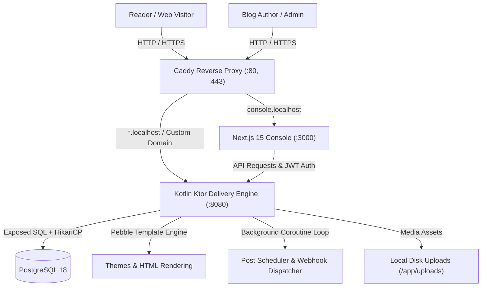

# Multi-Tenant Blogging Platform Setup & Deployment Guide

This guide walks you through setting up, configuring, and operating the blogging platform—a high-performance, multi-tenant publishing platform engineered with a **Kotlin (Ktor)** delivery backend and a modern **Next.js 15 (App Router)** administration console.

---

## Table of Contents

1. [Quickstart (Docker Compose)](#1-quickstart-docker-compose)
2. [Local Hostname Resolution (`/etc/hosts`)](#2-local-hostname-resolution-etchosts)
3. [Configuration & Environment Variables](#3-configuration--environment-variables)
4. [Default Credentials & Initial Access](#4-default-credentials--initial-access)
5. [How the Platform Works](#5-how-the-platform-works)
   - [Architecture Topology](#architecture-topology)
   - [Multi-Tenant Routing & Domains](#multi-tenant-routing--domains)
   - [Public Blog Rendering & Theme Engine](#public-blog-rendering--theme-engine)
   - [Writing Studio & Multi-Language Variants](#writing-studio--multi-language-variants)
   - [Revision History & Rollback](#revision-history--rollback)
   - [Dynamic Open Graph & Social Cards](#dynamic-open-graph--social-cards)
   - [Scheduled Publishing & Background Jobs](#scheduled-publishing--background-jobs)
   - [Full Blog Backup & Data Export](#full-blog-backup--data-export)
6. [Bare-Metal Local Development (Without Docker)](#6-bare-metal-local-development-without-docker)
7. [Custom Domains & Automatic SSL (Production)](#7-custom-domains--automatic-ssl-production)
8. [Production Deployment Best Practices](#8-production-deployment-best-practices)
9. [Troubleshooting & FAQs](#9-troubleshooting--faqs)

---

## 1. Quickstart (Docker Compose)

The easiest and recommended way to run the platform is using Docker Compose. It orchestrates all four core services:
- **`blog-postgres`**: PostgreSQL 18 database.
- **`blog-backend`**: Kotlin 21 + Ktor delivery and API service.
- **`blog-console`**: Next.js 15 + React 19 administration dashboard.
- **`blog-caddy`**: Reverse proxy with automatic On-Demand TLS certificate management.

### Step 1: Configure Environment

```bash
# Copy sample environment configuration
cp .env.example .env.app
```

### Step 2: Start All Services

```bash
docker compose up -d --build
```

### Step 3: Verify Container Health

```bash
docker compose ps
```

All 4 services should report `Up` and `healthy`:
```text
NAME            SERVICE    STATUS                   PORTS
blog-backend    backend    Up (healthy)             0.0.0.0:8080->8080/tcp
blog-caddy      caddy      Up                       0.0.0.0:80->80/tcp, 0.0.0.0:443->443/tcp
blog-console    console    Up                       0.0.0.0:3000->3000/tcp
blog-postgres   db         Up (healthy)             0.0.0.0:5432->5432/tcp
```

---

## 2. Local Hostname Resolution (`/etc/hosts`)

Because the platform is **multi-tenant** and distinguishes blogs by host header (`<subdomain>.localhost` or custom domains), add the following entries to your `/etc/hosts` file (macOS / Linux) or `C:\Windows\System32\drivers\etc\hosts` (Windows):

```text
127.0.0.1   console.localhost
127.0.0.1   tech.localhost
```

Once mapped:
- **Admin Console**: [http://console.localhost](http://console.localhost) (or direct: [http://localhost:3000](http://localhost:3000))
- **Sample "Tech" Blog**: [http://tech.localhost](http://tech.localhost) (or direct: [http://localhost:8080](http://localhost:8080) with `Host: tech.localhost`)

---

## 3. Configuration & Environment Variables

All core runtime parameters are specified in `.env.app`:

```ini
# Domain routing
BASE_DOMAIN=localhost
CONSOLE_DOMAIN=console.localhost

# PostgreSQL Credentials
DB_USER=postgres
DB_PASSWORD=supersecurepassword123
DB_NAME=blogdb

# Security & JSON Web Tokens (JWT)
JWT_SECRET=super-secret-jwt-key-replace-with-a-random-32-char-string-in-prod
JWT_ISSUER=blogs-backend
JWT_AUDIENCE=blogs-console

# File Upload Storage Directory
STORAGE_UPLOADS_DIR=/app/uploads

# Optional AI Assistant (OpenAI, Groq, Ollama, OpenRouter)
AI_API_KEY=
AI_BASE_URL=https://api.openai.com/v1
AI_MODEL=gpt-4o-mini
```

> [!IMPORTANT]
> In production environments, generate a cryptographically strong 32+ character random string for `JWT_SECRET` and replace `DB_PASSWORD`.

---

## 4. Default Credentials & Initial Access

On first boot, Flyway migrations `V1` through `V8` automatically run and seed initial sample data.

### Default Admin Account
- **URL**: [http://console.localhost](http://console.localhost) or [http://localhost:3000/login](http://localhost:3000/login)
- **Email**: `admin@example.com`
- **Password**: `password123`

### Pre-Seeded Sample Blog
- **Title**: `Tech & Engineering Dispatch`
- **Subdomain**: `tech`
- **Sample Post**: [http://tech.localhost](http://tech.localhost)

---

## 5. How the Platform Works



### Architecture Highlights

### Multi-Tenant Routing & Domains
- Requests entering the Ktor delivery engine extract the host header.
- If the host matches `<subdomain>.localhost` or `<subdomain>.yourdomain.com`, the subdomain is matched against `blogs.subdomain`.
- If the host matches a custom domain (e.g. `blog.company.com`), it is matched against `blogs.custom_domain`.
- Caddy's `on_demand_tls` queries `GET /api/internal/check-domain?domain=...` prior to obtaining Let's Encrypt certificates, preventing certificate exhaustion abuse.

### Public Blog Rendering & Theme Engine
- High-performance, server-rendered HTML powered by **Pebble Templates**.
- Located in `backend/src/main/resources/themes/default/`:
  - `layout.pebble`: Base skeleton with `<head>` meta tags, dark mode scripts, reading progress bar, navigation, and footer code injection.
  - `index.pebble`: Homepage article stream, featured posts, search trigger, and pagination.
  - `post.pebble`: Full article layout with reading time badge, sticky Table of Contents (TOC), comment section, and author cards.
  - `tag.pebble`: Filtered post listing by category/tag.
- Built-in Atom/RSS feed generated dynamically at `/feed.atom` and XML sitemap at `/sitemap.xml`.

### Writing Studio & Multi-Language Variants
- Rich text authoring studio powered by **TipTap** with Markdown shortcuts, code blocks, tables, callout blocks, and direct image uploads.
- **First-Class Internationalization**: A single post record can hold multiple localized variants (`en`, `es`, `fr`, etc.) with independent titles, slugs, and HTML content.
- **AI Assistant**: 1-click automatic post translation and SEO meta description generation.

### Revision History & Rollback
- Every time a post variant is saved, a snapshot is automatically recorded into `post_revisions`.
- Post Studio provides a **History** modal displaying:
  - Timestamp & relative age
  - Author identity
  - Word count & status badge
  - Visual preview of past content
  - **1-Click Rollback**: Restores past snapshots directly back into the live editor.

### Dynamic Open Graph & Social Cards
- Visiting `/api/og/{slug}` automatically generates an SVG image card (1200×630) styled with ambient gradient glows, publication logo, post title, date, reading time, and domain branding.
- Social networks (Twitter, LinkedIn, Slack, Discord) read these vector social preview cards directly via standard `<meta property="og:image">` tags.

### Scheduled Publishing & Background Jobs
- Posts can be scheduled to go live at an exact future date and time.
- The backend `SchedulerService` coroutine polls every 30 seconds, automatically transitioning status from `SCHEDULED` to `PUBLISHED` and dispatching webhook notifications to external integrations.

### Full Blog Backup & Data Export
- Found in **Settings → General & Domain → Full Blog Backup & Data Export**.
- Generates an offline `.zip` archive containing:
  - `metadata.json`: Blog configuration, theme, typography, and styling settings.
  - `data/tags.json`: Complete tags metadata.
  - `data/comments.json`: All reader comments and moderation statuses.
  - `data/subscribers.csv`: Reader email subscriber list.
  - `posts/{lang}/{slug}.md`: Clean Markdown files with complete YAML frontmatter.

---

## 6. Bare-Metal Local Development (Without Docker)

If you prefer to run services natively on your host machine for development:

### Prerequisites
- **JDK 21** (`java -version`)
- **Node.js 20+** & **npm** (`node -v`)
- **PostgreSQL 18** running locally on port `5432`

### 1. Database Setup
Create database `blogdb` and user `postgres`:
```bash
createdb blogdb
```

### 2. Backend Startup
```bash
cd backend

export DATABASE_URL="jdbc:postgresql://localhost:5432/blogdb"
export DATABASE_USER="postgres"
export DATABASE_PASSWORD="supersecurepassword123"
export JWT_SECRET="your-development-jwt-secret-string-at-least-32-chars"
export STORAGE_UPLOADS_DIR="./uploads"

./gradlew run
```
The backend starts on `http://localhost:8080`. Flyway will automatically apply migrations.

### 3. Console Startup
```bash
cd console
npm install
npm run dev
```
The Next.js console starts on `http://localhost:3000`.

---

## 7. Custom Domains & Automatic SSL (Production)

The platform supports unlimited custom domains with zero-touch SSL certificate provisioning.

### Step 1: DNS Configuration for Client Domain
Ask your blog owner or client to create a **CNAME** DNS record:
```text
Type:  CNAME
Name:  blog (or @ for apex domain)
Value: your-server-ip-or-domain.com
```

### Step 2: Verification in Console
1. Navigate to **Console → Blog Settings → General & Domain**.
2. Enter the domain in **Custom Domain (Optional)** (e.g., `blog.mycompany.com`).
3. Click **Verify DNS Now**. The built-in DNS resolver checks that the domain correctly resolves before marking it `VERIFIED`.

### Step 3: Caddy Automatic On-Demand TLS
When a visitor accesses `https://blog.mycompany.com`:
1. Caddy intercepts the TLS handshake.
2. Caddy sends an internal query: `GET http://backend:8080/api/internal/check-domain?domain=blog.mycompany.com`.
3. If verified, Caddy dynamically requests and provisions an SSL certificate from Let's Encrypt / ZeroSSL.

---

## 8. Production Deployment Best Practices

### Recommended Hardware Requirements
- **CPU**: 2 vCPUs minimum (4 vCPUs recommended for high traffic).
- **RAM**: 2 GB minimum (4 GB recommended).
- **Disk**: 20+ GB SSD (dependent on uploaded media volume).

### Backup Strategy
Regularly backup the following Docker persistent volumes:
1. **Database**:
   ```bash
   docker compose exec db pg_dump -U postgres blogdb | gzip > backup-$(date +%F).sql.gz
   ```
2. **Uploaded Media Files**:
   Backup volume `uploads_data` (`/var/lib/docker/volumes/..._uploads_data/_data`).

### Health Checks & Monitoring
- Backend Health Check: `GET /health` returns `200 OK` with JSON `{"status": "UP"}`.
- Caddy Metrics: Available at `http://localhost:2019/metrics` if enabled.

---

## 9. Troubleshooting & FAQs

### Port 80 or 443 Already in Use
If Apache or Nginx is running on your host machine:
```bash
sudo systemctl stop nginx
sudo systemctl disable nginx
```
Or change host port bindings in `docker-compose.yml`.

### Resolving Subdomains on Localhost
If `tech.localhost` does not resolve in your browser:
- Modern Chrome/Firefox automatically resolves `*.localhost` to `127.0.0.1`.
- If using Safari or custom DNS resolvers, manually add `127.0.0.1 tech.localhost` to `/etc/hosts`.

### Resetting Admin Password
To update the admin password directly in PostgreSQL:
```bash
docker compose exec db psql -U postgres -d blogdb -c "
UPDATE users 
SET password_hash = '\$2a\$12\$IRtxFEz6WBvgVf9o/ZRDleLBg7MaJV7XLXPaGhjbDtdoUOTZFsK4O' 
WHERE email = 'admin@example.com';
"
```
*(Sets password back to `password123`)*
